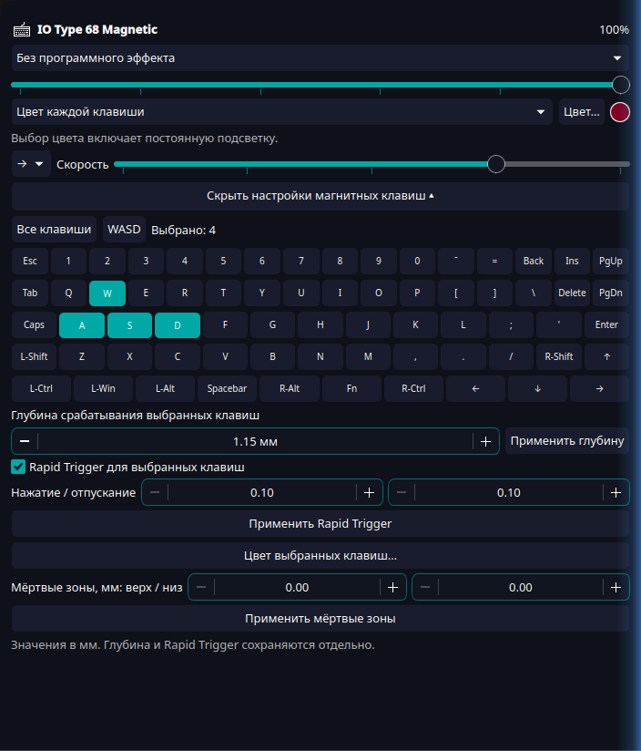

# IO Type 68 Magnetic для Linux

Открытый пользовательский HID-драйвер, служба D-Bus, CLI и виджет KDE Plasma 6. Перепрошивка и модуль ядра не нужны.

Поддерживаются яркость 0–5, выключение, RGB всей клавиатуры/отдельных клавиш, встроенные эффекты со скоростью и направлением; глубина срабатывания 0,10–3,20 мм; выбор всех клавиш, WASD и отдельных клавиш; Rapid Trigger с раздельными порогами нажатия/отпускания; верхняя и нижняя мёртвые зоны 0–0,50 мм.

Программные эффекты: северное сияние, мягкое дыхание, комета, радужная волна. Планировщик стремится к 30 кадрам/с, отправляя временные кадры `0x32`. Постоянная таблица RGB не записывается на каждом кадре. Эффекты работают, пока запущена служба.

Экспериментальная поддержка проверена на одном устройстве `0c45:0256`, прошивка 1.37. Изменение глубины не меняет физическое усилие пружин. Запись настроек проверяется чтением, но это не измерение реальной глубины датчика.

На прошивке 1.37 произвольный RGB включает пользовательский постоянный режим. Цвет любого встроенного анимированного эффекта менять не обещаем. Макросы, переназначение, SOCD/DKS, калибровка, обновление прошивки и заводской сброс не реализованы.

Установка, команды и удаление приведены в [README](../README.md). Установка выполняется для пользователя, доступ к HID настраивается отдельным правилом udev. Никаких личных настроек материнской платы, памяти или монитора в проекте нет. Существующий расширенный виджет яркости не заменяется автоматически.

## Установка одной командой

Из распакованной папки проекта:

```sh
python3 install.py
```

Запускай без sudo. Установщик сам запросит пароль только для системных зависимостей/правила USB. Проверит конфликты, установит мост и виджет для пользователя, перезагрузит правила USB, запустит службу и проверит соединение. Затем добавь виджет «IO Type 68 Magnetic» через меню KDE.

Удаление: `python3 install.py --uninstall`. Файлы другой установки и изменённые вручную файлы не удаляются. Текущий старый мост защищён от перезаписи: для перехода понадобится отдельно сохранить и убрать его, поскольку он также обслуживает подсветку ПК и монитор.

## Виджет в KDE



Реальный скриншот отдельного виджета в Plasma 6.7.5. Настройки прочитаны с клавиатуры через установленный мост. В кадре только виджет, без личных окон рабочего стола.
